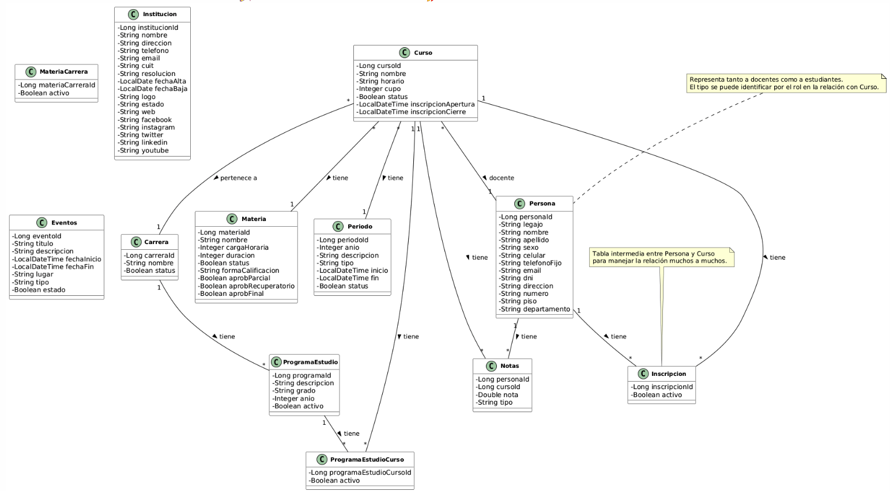
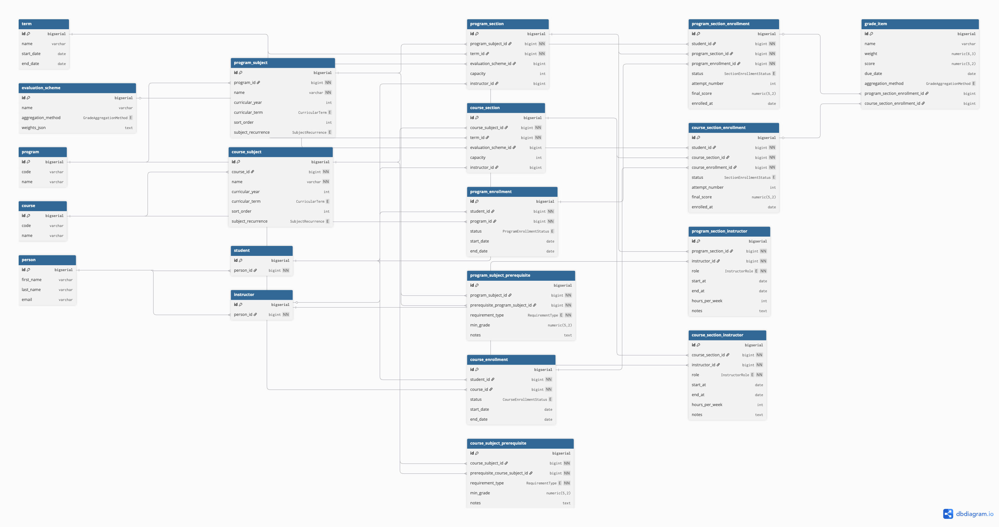

# Aplicación de Gestión Educativa

Aplicación web para la gestión de una institución educativa, desarrollada con Spring Boot en el backend y React en el frontend.

## 🏗️ Arquitectura

El proyecto sigue una arquitectura de tres capas:

### Backend (Spring Boot)
- **Capa de Entidades**: Modelos de datos que representan las tablas de la base de datos.
- **Repositorios**: Interfaces que extienden `JpaRepository` para el acceso a datos.
- **Servicios**: Lógica de negocio y reglas de la aplicación.
- **Controladores**: Manejan las peticiones HTTP y devuelven respuestas.
- **DTOs**: Objetos para transferencia de datos entre capas.
- **Seguridad**: Autenticación y autorización con JWT.
- **Migraciones**: Versionado de esquema con Flyway.

### Frontend (React + Vite)
- **Componentes**: UI reutilizables.
- **Vistas**: Páginas principales de la aplicación.
- **Servicios**: Llamadas a la API del backend.
- **Contexto**: Gestión del estado global de la aplicación.
- **Ruteo**: Navegación con React Router.

### Base de Datos
- MySQL/PostgreSQL para almacenamiento persistente.
- Migraciones con Flyway.

## 🗄️ Modelo de Datos

- **Diagrama DER (versión previa)**  
  

- **Nuevo DDL v2**  
  

  Enlace directo en GitHub (opcional):  
  https://github.com/Gabriel030/agustina-bermejo-app/blob/master/backend/src/main/java/com/red_escuela/backend/repository/der/DDL-v2.png

## 🚀 Características Principales

- Gestión de estudiantes y docentes
- Administración de cursos y materias
- Sistema de inscripciones
- Gestión de calificaciones
- Programas de estudio
- Eventos institucionales
- Seguridad con JWT y control de acceso por roles
- Migraciones automáticas con Flyway

## 🆕 Novedades de esta versión

- **DDL v2** con relaciones, claves foráneas e índices actualizados.
- **Migraciones Flyway** alineadas al nuevo esquema.
- **DTOs y servicios** ajustados al nuevo modelo de datos.
- **Endpoints actualizados** para reflejar cambios en entidades y relaciones.
- **Mejoras de seguridad** y manejo de roles/permisos.
- **Ajustes de frontend** para consumir los nuevos contratos del backend.

## 🛠️ Tecnologías Utilizadas

### Backend
- Java 17
- Spring Boot 3.x
- Spring Security
- JPA/Hibernate
- JWT
- Flyway
- Maven

### Frontend
- React 18
- Vite
- TypeScript
- Tailwind CSS
- React Router
- Axios

## 📦 Requisitos Previos

- Java 17 o superior
- Node.js 16+ y npm/yarn
- Base de datos MySQL/PostgreSQL
- Maven 3.6+

## 🚀 Instalación

1. Clonar el repositorio
2. Configurar la base de datos en `backend/src/main/resources/application.properties`
3. Ejecutar el backend:
   ```bash
   cd backend
   mvn spring-boot:run

4. Ejecutar el frontend:
   ```bash

   cd frontend
   npm install
   npm run dev
   ```

## 📊 Observabilidad (opcional)

El backend expone métricas en `/actuator/prometheus` (protegido con Basic) y
logs estructurados en JSON cuando corre con el perfil `prod`.

Para ver las métricas en un Grafana local, con un año de retención:

```bash
cp ops/prometheus/scrape_password.example ops/prometheus/scrape_password
# editar ese archivo con el valor de ACTUATOR_PASSWORD

GRAFANA_ADMIN_PASSWORD=<elegí-una> docker compose -f docker-compose.observability.yml up -d
```

Prometheus queda en `localhost:9090` y Grafana en `localhost:3000`, con el
datasource ya configurado. Va aparte del `docker-compose.yml` principal a
propósito: no hace falta levantar el monitoreo cada vez que se trabaja en la
app. Requiere el backend corriendo en el host con `ACTUATOR_USER` y
`ACTUATOR_PASSWORD` seteadas.

## 📝 Licencia

Este proyecto está bajo la Licencia MIT.
